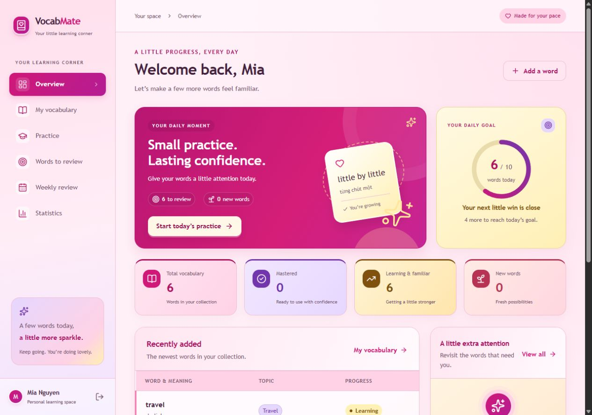
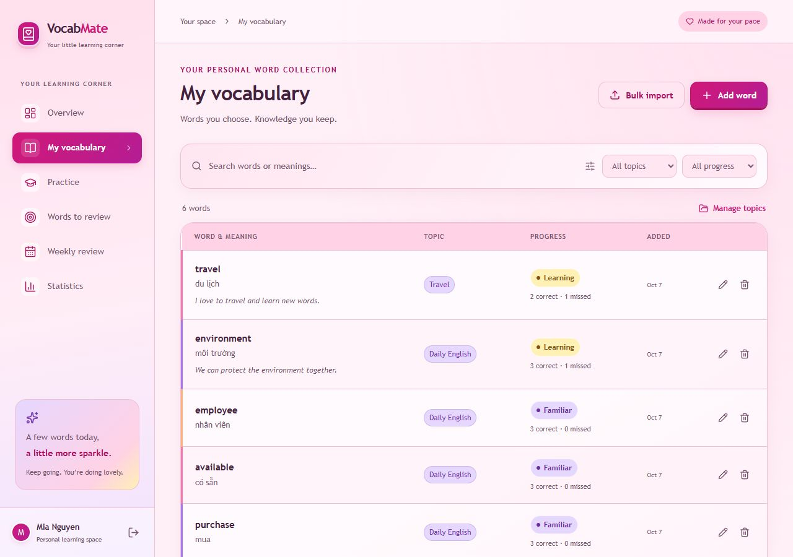
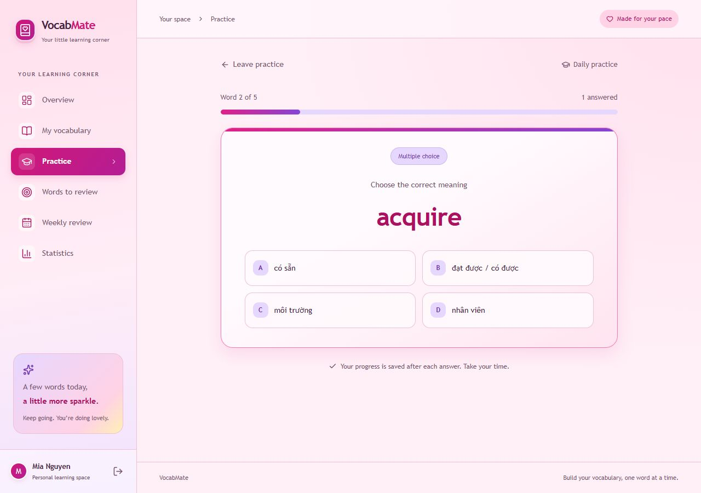
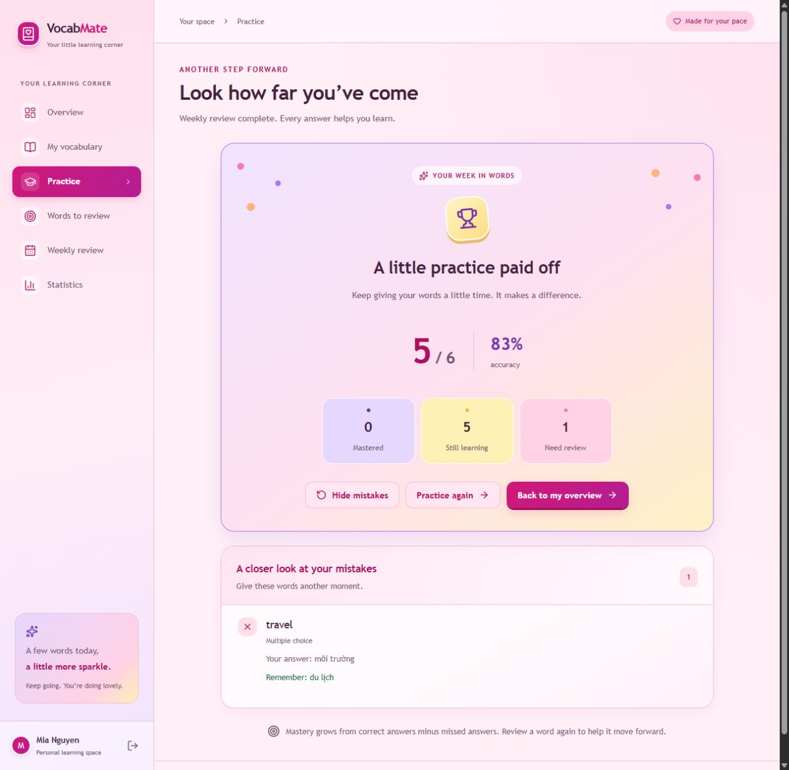
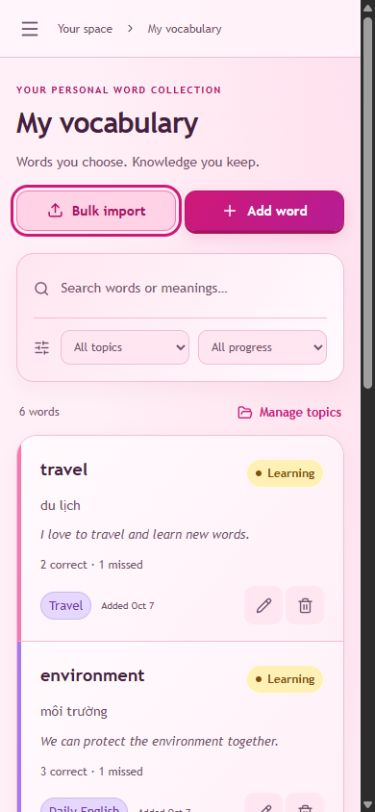

# VocabMate

VocabMate is a personal English vocabulary learning application. Add words and Vietnamese meanings, organize them into topics, practice in four modes, and review the words that need more attention. A weekly test brings together vocabulary from the previous seven days and older weak words.

The project keeps a small, readable architecture suitable for a university software project. The frontend talks to the real REST API, and PostgreSQL stores each user's own library and learning history.

## Features

- Registration, login, protected pages, and vocabulary ownership checks.
- Vocabulary creation, editing, deletion, search, topic/mastery filters, and bulk import.
- Topic creation, renaming, and safe deletion.
- Flashcards, multiple choice, Vietnamese meaning entry, and reverse English quizzes.
- Per-word progress, four mastery levels, and practice for weak words.
- Daily practice recommendations and a goal of ten distinct words per UTC day.
- Weekly reviews of up to twenty distinct words, results, and mistake review.
- Saved unfinished practice sessions, including weekly reviews, that can be resumed.
- Dashboard and statistics for mastery, accuracy, completed quizzes, and vocabulary growth.
- A vibrant pink learning interface, colorful progress cards, supportive quiz feedback, mobile vocabulary cards, keyboard navigation, and loading, empty, validation, and error states.

## Technology and architecture

| Part           | Technology                                                    |
| -------------- | ------------------------------------------------------------- |
| Frontend       | React, Vite, TypeScript, Tailwind CSS, React Router, Axios    |
| Backend        | ASP.NET Core Web API, .NET 8, Entity Framework Core 8         |
| Authentication | Password hashing and eight-hour JWT access tokens             |
| Database       | PostgreSQL with EF Core migrations                            |
| Development    | Git, GitHub, optional Docker Compose, backend automated tests |

Controllers handle HTTP requests, services implement the learning rules, and EF Core accesses the database directly. DTOs keep database entities out of API responses. A central Axios client attaches the JWT, and protected React routes handle the signed-in experience. See [architecture](docs/architecture.md), [database design](docs/database.md), [business rules](docs/business-rules.md), and the [design system](docs/design-system.md). The [demo guide](docs/demo-guide.md) explains how to present the complete learning workflow.

## Project structure

```text
VocabMate/
├── frontend/                   # React application
├── backend/
│   ├── VocabMate.Api/           # Controllers, services, DTOs, entities, data, migrations
│   ├── VocabMate.Tests/         # Backend tests
│   └── VocabMate.sln
├── docs/                       # API contract, design, rules, milestone task list
├── scripts/                    # Optional Windows development helpers
├── .config/dotnet-tools.json    # Repository-local EF CLI
├── .env.example                # Blank Docker database configuration
├── docker-compose.yml          # Local PostgreSQL
└── README.md
```

## Prerequisites

- .NET 8 SDK. `global.json` selects the installed compatible .NET 8 feature band.
- Node.js 22.12 or newer and npm.
- PostgreSQL 17/18, or Docker with Docker Compose.
- Git; GitHub CLI is optional.

Run `dotnet --info`, `node --version`, and `npm --version` to check your tools. Docker only runs the database; the API and frontend run locally.

## Installation and database setup

Clone this repository and enter its root directory:

```sh
git clone https://github.com/TeoMichael/VocabMate.git
cd VocabMate
```

The repository is private, so GitHub access is required. Restore project dependencies:

```sh
dotnet restore backend/VocabMate.sln
dotnet tool restore
cd frontend
npm ci
cd ..
```

To use Docker, copy `.env.example` to `.env`. Set a local database username and a strong, unique password in `.env`; both example values are intentionally blank. Then start PostgreSQL:

```sh
docker compose up -d db
docker compose ps
```

The Compose database is `vocabmate` at `127.0.0.1:5432`. Its data persists in the `postgres-data` named volume. `docker compose down` stops the container without removing that volume. If port 5432 is already in use, change the host port in `docker-compose.yml` and use the same port in the backend configuration.

For an existing PostgreSQL server, create a `vocabmate` database owned by a dedicated login role. That role needs permission to create tables in its own database for migrations. Use your server's host, port, and credentials below.

## Environment configuration

Choose either helper setup or manual setup. Both create the same ignored `backend/VocabMate.Api/appsettings.Development.json` configuration.

**Windows helper:** after configuring the Docker `.env` file, run:

```powershell
powershell -NoProfile -ExecutionPolicy Bypass -File scripts/setup-local.ps1 -UseDocker
```

The helper reads Docker Compose's resolved database environment and published port, and generates a random 64-byte JWT key when one is missing. It preserves existing configured values and fills a blank copied example file. A complete configuration remains unchanged. Invalid JSON or an existing key shorter than the API's 32-byte minimum is rejected without overwriting the file. The helper never prints credentials or signing keys.

For another PostgreSQL server, supply `ConnectionStrings__DefaultConnection` through your shell and call the helper without `-UseDocker`. In this original workspace, it can instead reuse the ignored portable database configuration described below.

**Manual setup:** copy `backend/VocabMate.Api/appsettings.Example.json` to `backend/VocabMate.Api/appsettings.Development.json`. Fill `ConnectionStrings:DefaultConnection` using your own host, port, database, username, and password. Set `Jwt:Key` to a cryptographically random secret of at least 64 bytes. Keep `Jwt:Issuer` as `VocabMate`, `Jwt:Audience` as `VocabMate.Web`, and `FrontendUrl` as `http://localhost:5173` for local development.

The development file is ignored by Git. Do not add credentials to `appsettings.json`, example files, source code, documentation, or commits.

The API also accepts environment variables, which override JSON configuration:

| Variable                               | Purpose                                                       |
| -------------------------------------- | ------------------------------------------------------------- |
| `ConnectionStrings__DefaultConnection` | PostgreSQL connection string                                  |
| `Jwt__Key`                             | Random JWT signing secret                                     |
| `Jwt__Issuer`                          | Token issuer, `VocabMate`                                     |
| `Jwt__Audience`                        | Token audience, `VocabMate.Web`                               |
| `FrontendUrl`                          | Allowed browser origin, normally `http://localhost:5173`      |
| `ASPNETCORE_ENVIRONMENT`               | Set to `Development` for local JSON configuration and Swagger |

Copy `frontend/.env.example` to `frontend/.env` if you need to customize the API URL. Its default is:

```dotenv
VITE_API_URL=http://localhost:5080/api
```

`VITE_` variables are public browser configuration. Never put secrets in them.

## Apply migrations

Start PostgreSQL first. From the repository root, use Development configuration and apply the committed migrations:

```powershell
$env:ASPNETCORE_ENVIRONMENT = 'Development'
dotnet tool restore
dotnet ef database update --project backend/VocabMate.Api
```

For Bash, use `export ASPNETCORE_ENVIRONMENT=Development` before the same `dotnet` commands. Migrations create the application schema; the database itself must already exist. The application does not seed a shared demonstration account or mock vocabulary. Register and add your own words.

When changing entities during development, create and review a new migration:

```sh
dotnet ef migrations add DescriptiveChangeName --project backend/VocabMate.Api
dotnet ef database update --project backend/VocabMate.Api
```

## Run locally

In terminal one, start the API:

```powershell
$env:ASPNETCORE_ENVIRONMENT = 'Development'
dotnet run --project backend/VocabMate.Api --no-launch-profile --urls http://localhost:5080
```

In terminal two, start React:

```sh
cd frontend
npm run dev -- --host localhost
```

Open `http://localhost:5173`. The API is at `http://localhost:5080/api`, with Swagger at `http://localhost:5080/swagger` in Development. Register an account, add several words with different meanings, and start a practice session. New accounts unlock their first weekly review seven days after registration.

Windows helpers provide the same launch commands from the project root:

```powershell
powershell -NoProfile -ExecutionPolicy Bypass -File scripts/run-backend.ps1
powershell -NoProfile -ExecutionPolicy Bypass -File scripts/run-frontend.ps1
```

The `ExecutionPolicy` option applies only to that PowerShell process; it avoids changing the machine's policy when local scripts are disabled.

If the frontend receives connection errors, confirm the API is running on port 5080 and that `VITE_API_URL` matches. Restart Vite after editing `.env`. A `401` response clears the expired browser session and returns to login.

## Build and test

```sh
dotnet build backend/VocabMate.sln
dotnet test backend/VocabMate.sln
cd frontend
npm run build
npm run lint
npm run format:check
```

The frontend production bundle is written to `frontend/dist`. Test coverage focuses on authentication, ownership, library operations, answer scoring, mastery, weak-word detection, and weekly selection. The audit verification includes 47 passing backend tests, 179 live PostgreSQL assertions, and 11 isolated startup-helper assertions. A clean isolated `npm ci` reported zero vulnerabilities. Docker configuration was stub-tested because Docker is unavailable on this machine; actual container startup was not tested. See [verification details](docs/verification.md) for the recorded build and browser checks.

With the API and PostgreSQL running, optional HTTP smoke checks use PowerShell 7 to create fresh verification accounts and exercise the live API:

```powershell
pwsh -NoProfile -ExecutionPolicy Bypass -File scripts/smoke-api.ps1
```

This script leaves those uniquely named verification accounts in the local database so their results can be inspected. Use a development database.

## API overview

All protected requests need `Authorization: Bearer <token>`. The frontend adds this automatically. JSON properties use camelCase; enum values use uppercase strings. For full payloads and responses, see [the API contract](docs/api-contract.md).

| Route                                                                 | Purpose                                                  |
| --------------------------------------------------------------------- | -------------------------------------------------------- |
| `POST /api/auth/register`, `POST /api/auth/login`                     | Obtain a token and user details                          |
| `GET /api/auth/me`                                                    | Current authenticated user                               |
| `GET/POST /api/topics`, `PUT/DELETE /api/topics/{id}`                 | Topic management                                         |
| `GET/POST /api/vocabularies`, `GET/PUT/DELETE /api/vocabularies/{id}` | Vocabulary management                                    |
| `POST /api/vocabularies/import`                                       | Import one `word - meaning` pair per line                |
| `POST /api/practice`                                                  | Create regular, weak-word, or weekly practice            |
| `GET /api/practice/weekly`                                            | Weekly availability, active review, and seven-day window |
| `GET /api/quizzes`, `GET /api/quizzes/{id}`                           | Completed history, saved session, and results            |
| `GET /api/quizzes?completed=false`                                    | Unfinished sessions available to resume                  |
| `POST /api/quizzes/{id}/answers`                                      | Submit an answer and update progress                     |
| `POST /api/quizzes/{id}/questions/{questionId}/reveal`                | Reveal a flashcard before self-assessment                |
| `GET /api/statistics`                                                 | Dashboard, daily goal, accuracy, and growth              |
| `GET /api/health`                                                     | API availability                                         |

Bulk import example:

```text
acquire - đạt được / có được
purchase - mua
available - có sẵn
employee - nhân viên
```

Valid lines become separate entries. Invalid lines return their original line numbers and reasons so the user can correct them. Imports allow up to 500 nonblank lines; blank lines do not consume that limit.

## Screenshots

These screenshots show the vibrant pink interface with real vocabulary entered through the application and stored in PostgreSQL. They include different moments in the learning workflow, so question numbers and totals can differ. The local demonstration account is retained only in this development workspace; it is not seeded in cloned repositories. Follow the [demo guide](docs/demo-guide.md) to recreate the workflow with your own account.











More views: [login](docs/screenshots/login.jpg), [registration](docs/screenshots/register.jpg), [practice modes](docs/screenshots/practice-modes.jpg), [flashcards](docs/screenshots/flashcard.jpg), [multiple choice](docs/screenshots/multiple-choice.jpg), [correct answer feedback](docs/screenshots/quiz-feedback.jpg), [missed answer feedback](docs/screenshots/incorrect-feedback.jpg), [weak words](docs/screenshots/weak-words.jpg), [weekly review](docs/screenshots/weekly-review.jpg), [statistics](docs/screenshots/statistics.jpg), and [mobile practice](docs/screenshots/mobile-practice.jpg).

## Optional appendix: this workspace's portable tools

The original development workspace includes ignored `.local/` tools because Docker and system npm were unavailable. These files are machine-specific and are not part of the Git repository. Other developers should use the normal prerequisites above.

- Portable PostgreSQL 18.6 listens only on `127.0.0.1:55432`.
- `.local/database.json` stores its generated credentials and executable paths.
- `.local/demo-account.json` stores the retained local demo login. Its credentials are absent from Git; cloned projects should register their own account.
- `powershell -NoProfile -ExecutionPolicy Bypass -File .local/start-postgres.ps1` starts it; `.local/stop-postgres.ps1` stops it.
- `powershell -NoProfile -ExecutionPolicy Bypass -File scripts/setup-local.ps1` can reuse that ignored database configuration.
- The frontend helper falls back to `.local/npm/package/bin/npm-cli.js` when npm is absent from `PATH` and Node is available.

## Future development

Possible later work includes scheduled weekly reminders, adjustable mastery rules, more flexible imports, accessibility improvements, and production deployment with HTTPS and secret management. Refresh tokens and server-side session revocation can be added if longer sessions become necessary.

AI chat, generated definitions, speech recognition, pronunciation scoring, OCR, machine learning, social features, complex gamification, and native mobile applications are outside V1.
