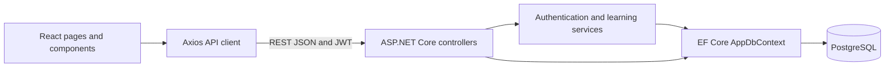

# Architecture

VocabMate uses a React frontend, one ASP.NET Core API, and one PostgreSQL database. This keeps the complete learning workflow understandable and avoids extra deployment services.

## Frontend responsibilities

React Router provides public authentication pages and protected learning pages. Shared layout and form components keep navigation, buttons, loading indicators, and error messages consistent. Pages request actual API data; no mock library supplies the final application.

A central Axios instance owns the API base URL and attaches the bearer token. Authentication state stores the token in `sessionStorage`, scoped to a browser tab. Logging out removes that session. Expired or unauthorized API requests return the user to login. Authentication is also enforced by the API; route protection alone is not a security boundary.

The browser renders quiz prompts and submits answers. It does not calculate authoritative scores, mastery levels, weak status, or weekly eligibility. Those decisions belong to the server, which prevents accidental differences between pages or clients.

## Backend responsibilities

- **Controllers:** HTTP routes, request validation, authenticated user identification, and suitable response codes.
- **DTOs:** Small input/output shapes instead of exposing tracked EF entities.
- **Services:** Password/token work, answer normalization, progress calculation, question generation, and weekly review selection.
- **Entities:** The persisted user, topic, vocabulary, progress, quiz, and question/result records.
- **Data:** `AppDbContext`, constraints, indexes, and migrations.
- **Central error handling:** Consistent ProblemDetails responses for request failures.

Controllers and services use EF Core directly. A separate repository layer would duplicate the small set of queries and is unnecessary for this MVP. There is no CQRS framework, event bus, background scheduler, machine learning component, or external definition provider.

## Ownership boundary

Every protected query scopes its records to the authenticated user ID from the JWT. The API does not accept a client-supplied user ID for assigning ownership. A vocabulary or quiz ID belonging to another user behaves like an unavailable record.

Topic assignment checks ownership before saving. Composite database foreign keys additionally prevent vocabulary from referring to another user's topic and prevent progress from referring to another user's vocabulary. Quiz creation selects only the user's vocabulary; answer and reveal endpoints first verify quiz ownership.

## Learning workflow

1. The user creates vocabulary, optionally assigning an owned topic.
2. Each vocabulary receives one initial progress row.
3. Starting practice saves a quiz and its ordered question snapshots.
4. The API returns prompts without revealing unanswered solutions. Flashcards reveal their meaning through a separate action.
5. Answer submission validates the saved question, grades it, records the answer, and updates word progress together.
6. Completing all questions sets the quiz completion time. Results and dashboard statistics read the stored records.

Saved question snapshots keep the session consistent if the underlying vocabulary is edited or deleted later. Optimistic concurrency tokens protect progress and quiz results from competing answer submissions. The API rejects already answered questions rather than counting the same answer again.

## Weekly review design

Weekly availability is computed when requested, using registration time or the latest completed weekly quiz. There is no scheduled job in V1. The selection and eligibility logic is held in services, so a future background reminder can call the same rules without changing scoring.

## Configuration and local development

The repository contains blank configuration examples, not secrets. Backend secrets belong in ignored development settings, environment variables, or user secrets. Docker database credentials belong in ignored `.env`. The frontend API URL is public configuration.

Local browser and API ports are 5173 and 5080. CORS permits the configured frontend origin. EF migrations are applied explicitly during setup. Tests exercise important rules and API ownership without requiring an unnecessary production infrastructure stack.

## Deliberate V1 limits

JWTs expire after eight hours. Logout removes the local token but does not revoke a token already copied elsewhere; V1 has no refresh tokens or server-side revocation list. Daily practice uses UTC days. Learning rules are deterministic, transparent, and intentionally simple. Production hosting, HTTPS termination, backups, and operational monitoring need a separate deployment setup.
