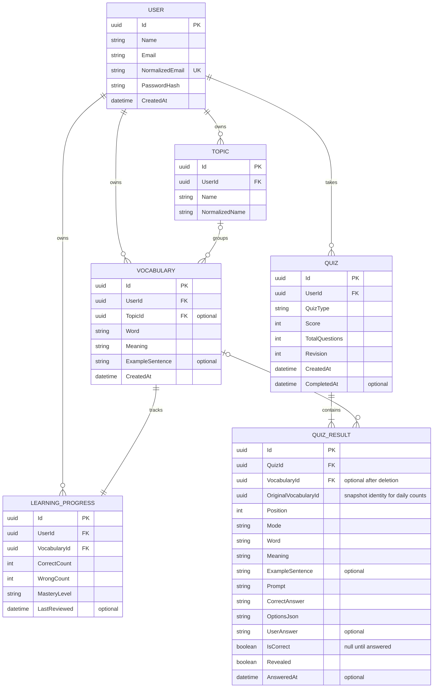

# Database design

PostgreSQL stores GUID primary keys, UTC timestamps, and enum names as strings. EF Core migrations describe the schema. API DTOs expose only fields needed by the interface; password hashes and normalized search keys are not public response fields.



## Entity purposes

| Entity | Purpose |
| --- | --- |
| User | Account details, secure password hash, and registration time |
| Topic | User-specific grouping such as TOEIC or Travel |
| Vocabulary | The user's word, meaning, example, optional topic, and creation time |
| LearningProgress | One cumulative progress record per vocabulary |
| Quiz | A saved practice session and its final score/completion time |
| QuizResult | An ordered question snapshot and its eventual answer/result |

`QuizResult` represents a question as soon as the quiz is created. `IsCorrect = null` means unanswered; `false` means an answered mistake. This distinction supports resumed sessions and avoids treating unfinished quizzes as completed tests.

## Keys, constraints, and indexes

- Every entity has an `Id` GUID primary key.
- `User.NormalizedEmail` is unique, so email case cannot create a second account.
- `(Topic.UserId, Topic.NormalizedName)` is unique; different users may use the same topic name.
- `(Topic.Id, Topic.UserId)` and `(Vocabulary.Id, Vocabulary.UserId)` are alternate keys used to enforce ownership in composite relationships.
- Vocabulary topic assignment references `(TopicId, UserId)`, preventing a cross-user topic reference in the database.
- Progress references `(VocabularyId, UserId)`. That pair is unique, so a vocabulary has only one progress record.
- `(Vocabulary.UserId, CreatedAt)` supports recent-word selection, and `(UserId, Word)` supports library lookup.
- `(LearningProgress.UserId, MasteryLevel)` supports mastery filters.
- `(Quiz.UserId, CreatedAt)` supports personal quiz history.
- A filtered unique index on `Quiz.UserId` allows only one unfinished `WEEKLY` session per user, including concurrent start requests.
- `(QuizResult.QuizId, Position)` is unique, preserving question order without duplicate positions.
- `CorrectCount`, `WrongCount`, quiz `Revision`, and answer `IsCorrect` participate in optimistic concurrency checks.

Words are not unique by spelling. A user can intentionally keep two entries with different meanings or topics. Topic names are unique per user after normalization.

## Deletion behavior

| Relationship | Behavior |
| --- | --- |
| User → owned topics/vocabulary/progress/quizzes | Cascade |
| Topic → vocabulary | Restrict; API returns conflict while the topic is in use |
| Vocabulary → learning progress | Cascade |
| Quiz → question/results | Cascade |
| Vocabulary → historical question/results | Set the optional vocabulary reference to null |

Quiz questions copy the original word, meaning, example, prompt, solution, and choices. `OriginalVocabularyId` retains a word's identity for distinct daily counts without a foreign key; the optional live `VocabularyId` is cleared on deletion. Deleting vocabulary removes its live progress but preserves those snapshots and historical scoring. Renaming a vocabulary word also does not change an existing quiz's solution. A deleted question still remains answerable from its snapshot, but cannot update progress for a word that no longer exists.

User deletion is described here as database behavior; the V1 interface does not include account deletion. Deleting a topic requires first moving its words to another topic, clearing their topic assignment, or deleting them.

## Length limits

Names and topic names allow up to 80 characters; email addresses 254; vocabulary words 120; meanings 500; example sentences 1,000. Saved answers allow up to 1,000 characters. Request validation should reject oversized values before they reach these database constraints.

## Migrations

From the repository root, restore the pinned EF Core CLI and apply the committed migration with the database already running:

```powershell
$env:ASPNETCORE_ENVIRONMENT = 'Development'
dotnet tool restore
dotnet ef database update --project backend/VocabMate.Api
```

The manifest pins `dotnet-ef` to 8.0.22. A migration creates the schema; it does not create the PostgreSQL login role or database. Connection credentials are supplied through ignored local configuration or environment variables.

For future model changes, create a descriptive migration, inspect its deletion/constraint operations, run tests, and apply it against a development database before committing. Keep production data backups separate from the repository.
