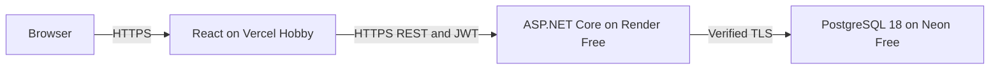

# Production deployment

**LIVE — verified on 2026-10-08.** Another person can open the public frontend, register, and use the real API and managed database without installing anything. This is a student deployment on free hosting, with the availability and recovery limits documented below.

## Production architecture



The existing private `TeoMichael/VocabMate` repository supplies both applications. Vercel uses the `frontend` root directory; Render builds the root `Dockerfile` in Singapore. Neon is a separate persistent database in the same region. Local PostgreSQL files, development settings, and demo accounts are never uploaded.

## Public URLs

- Frontend: <https://vocabmate-teomichael.vercel.app>
- API base: <https://vocabmate-api.onrender.com/api>
- Health: <https://vocabmate-api.onrender.com/api/health>

These are the verified stable provider addresses. Preview deployment URLs are not additional production CORS origins.

## Environment variables

Set these names in Render's environment settings only:

- `ASPNETCORE_ENVIRONMENT`
- `ConnectionStrings__DefaultConnection`
- `Jwt__Key`
- `Jwt__Issuer`
- `Jwt__Audience`
- `FrontendUrl`

Render supplies `PORT`. The startup script listens on that port on all container interfaces.

Only the following public configuration belongs in Vercel:

- `VITE_API_URL`

The controlled migration step temporarily also requires:

- `Migration__ExpectedHost`
- `Migration__ExpectedDatabase`

Never copy server secrets into frontend variables, source files, screenshots, documentation, or local deployment configuration. Production uses a new random signing key, separate from development. Keep the current issuer and audience. The connection uses certificate and hostname verification, and a maximum of ten client connections. V1 uses Neon's direct endpoint for both this small API pool and migrations, avoiding a separate migration credential.

## Deployment workflow

1. Review the change and any migrations. Run the local checks below.
2. Push the reviewed commit to `main` in the existing private repository.
3. Vercel installs with `npm ci`, then runs frontend tests, lint, formatting, and the production build. `frontend/vercel.json` supplies the SPA fallback and response headers. The hosted build rejects missing, insecure, localhost, or credential-bearing API URLs.
4. Render builds a multi-stage .NET 8 image, runs the backend tests in Release configuration, publishes only the API, and starts it as a non-root user. Development settings and build artifacts are excluded.
5. Check the provider build logs, the public health endpoint, registration/login, and one vocabulary/practice flow. A passing health check alone does not prove database access.

Both hosts deploy automatically from `main`. Render's **On Commit** setting was enabled only after the public checks passed and the one-time migration command was removed. Disable automatic deploy during initial setup of another database until its migrations have been applied and normal startup verified. `render.yaml` records the stable service configuration; the current service is dashboard-managed. Editing the YAML alone does not change that existing service.

```sh
dotnet restore backend/VocabMate.sln
dotnet build backend/VocabMate.sln -c Release --no-restore
dotnet test backend/VocabMate.sln -c Release --no-build --no-restore
dotnet publish backend/VocabMate.Api -c Release --no-build --no-restore
cd frontend
npm ci
npm run test
npm run build
npm run lint
npm run format:check
```

The original `v1.0.0` release tag remains unchanged. Deployment configuration follows that release on `main`; no new application version is needed for this infrastructure setup.

## Database migrations

Create the empty managed database before starting the API. Inspect the intended project, production branch, database, host, existing tables, and migration history. Set the expected target names independently in Render. The command checks those names against the actual connection string before connecting and requires verified TLS in Production.

For the first deployment, temporarily set Render's **Docker Command** to:

```sh
sh /app/start.sh --migrate
```

Render overrides the complete startup command, so passing a bare argument is insufficient. This runs the published API's guarded migration command, then starts the API only if migration succeeds. Logs list applied and pending migration names without credentials. Normal startup does not run migrations.

The committed migrations are:

- `20261007023911_InitialCreate`
- `20261007024137_PreserveReviewIdentity`

Both names were confirmed in production `__EFMigrationsHistory`, together with the six application tables and successful user, vocabulary, quiz, and progress writes. The Docker Command override and both temporary migration variables have been removed. A subsequent deployment started normally without running migrations. No production demo credentials are seeded.

For any future controlled migration, repeat these checks: confirm all committed migration names in history, inspect the schema, and verify application writes. Then clear the command override, remove both temporary variables, and redeploy normally.

For a future schema change, review the generated migration and test it on an isolated database first. Inspect a recovery point or take a private logical backup before a risky change. Disable automatic deploy while coordinating the schema update, apply the controlled command once against the verified target, remove it, and verify the app before re-enabling automatic deploy. Never run `EnsureDeleted`, recreate the database, or deploy multiple migration runners concurrently. Rolling back code does not undo schema changes.

## HTTPS, errors, and logs

Vercel and Render provide managed HTTPS. Render forwards traffic to the container over HTTP; the API does not introduce an internal HTTPS redirect or trust arbitrary forwarded headers. Creation responses use relative `Location` URLs so they remain HTTPS when resolved by the browser, even though the container receives HTTP. This behavior has a regression test and was verified through the real proxy. JWT authentication does not depend on proxy scheme or client address. Production CORS accepts only the exact configured HTTPS frontend origin; local development keeps its localhost origin.

Swagger is available only in Development. Production uses generic error responses and suppresses database-provider exception logging that could reveal connection details. Application errors log a trace identifier and exception type, without request bodies, access tokens, passwords, or connection strings.

Authentication rate limiting is not enabled in V1. A future limiter should be tested with Render's proxy and trusted client-address configuration before enabling per-IP buckets; blindly trusting forwarded headers or treating every visitor as the same proxy address would be unsafe or disruptive.

## Free-plan limits and recovery

Plans were checked on 2026-10-08: Vercel Hobby, Render Free in a Hobby workspace, and Neon Free. No paid plan or trial was activated, and no payment method or custom domain was added. Render's billing console showed no card on file and a $0.00 current monthly total.

- [Vercel Hobby](https://vercel.com/docs/plans/hobby) is intended for personal non-commercial projects. Its current allowances include 100 GB fast data transfer and one million CDN requests monthly. Do not upgrade or add paid services without approval.
- [Render Free](https://render.com/docs/free) provides 750 instance hours per workspace each month. The API sleeps after 15 idle minutes and can take about a minute to wake. Free instances have no shell, one-off jobs, persistent disk, or uptime guarantee. The filesystem is disposable, so all application data stays in Neon. Free database hosting on Render expires after 30 days, which is why this project uses Neon instead. Keep payment methods and paid overages disabled; exhausted free allowances can suspend service.
- [Neon Free](https://neon.com/docs/introduction/plans), including the [October storage update](https://neon.com/blog/neon-free-plan-1-gb-per-project), currently includes 1 GB storage per project, 100 CU-hours per project monthly, 5 GB monthly network transfer, and ten branches per project. Compute scales to zero after inactivity. The console reports six hours of automatic history retention, subject to the Free plan's history allowance. This is a short recovery window, not long-term independent backups. More retention or capacity would require an explicitly approved plan change.

## Troubleshooting

| Symptom | Check |
| --- | --- |
| CORS failure | Set the exact stable frontend origin in the API settings, without a path or trailing deployment-specific preview hostname. Redeploy the API. |
| Preview cannot use the production API | This is expected: only the stable production frontend origin is allowed. Use local development or explicitly plan an isolated preview environment. |
| Frontend calls localhost | Set the public API base in Vercel, then rebuild. Vite variables are fixed at build time. |
| Missing backend configuration | Set all server variables in Render and use the Production environment. The image deliberately contains no development secrets. |
| Migration exits before connecting | Verify the independently selected host/database and verified TLS. Do not weaken the guard to make it pass. |
| Migration or database access fails | Check the selected branch, role permissions, connection credentials, and provider compute state in the private console. Public errors omit those details. |
| Container exits before application logs | Use the full Docker Command shown above for migration; otherwise leave the override empty and use the image entrypoint. |
| Initial requests are slow | Allow Render and Neon to wake from free-plan inactivity. Avoid artificial keep-alive traffic. |
| Deep link returns 404 | Confirm Vercel's root directory is `frontend` and the deployed revision includes `vercel.json`. |
| New deployment fails | Inspect its build/test logs. Fix the failure without disabling checks; redeploy the reviewed commit. |
| A 401 returns to login | Sign in again after JWT expiry. The Axios client clears the invalid session centrally. |

## Verification results

| Area | Actual result |
| --- | --- |
| Backend locally | Release build and publish pass with zero warnings/errors; all 74 tests pass. |
| Backend on Render | Linux Docker image build passes all 74 Release tests; normal Production startup and public health return successfully. |
| Frontend | Clean `npm ci` reports zero vulnerabilities; four tests, TypeScript/Vite build, lint, and formatting pass. Vercel production deployment is Ready. |
| Database | Both migrations and six application tables verified in Neon's production SQL editor; browser-created user and vocabulary/quiz/progress rows persist. |
| Public API | 157 real HTTPS smoke assertions pass, including authentication, cross-user ownership, CRUD, import, quiz scoring, weak words, and saved sessions. |
| Public browser | Registration, logout/login, protected-route redirect, topic creation, vocabulary add/edit/search/topic filter, invalid-line bulk import, all four learning modes, progress, weak-word practice/recovery, statistics, and unfinished-session resume pass. |
| Mobile | Navigation, dashboard, vocabulary cards, edit/import forms, practice, results, and statistics inspected at 390×844; no obvious horizontal overflow. |
| Routes and errors | Seven direct SPA routes return 200; missing vocabulary and incorrect login display readable errors. Empty library, clear weak list, and unavailable weekly review render correctly. |
| HTTPS and CORS | Public API returns 200 health and 404 Swagger; exact frontend origin accepted, another origin rejected. Browser checks find no CORS, mixed-content, or localhost-connection errors. |
| Local support | Original local API and frontend still return 200; separate production rehearsal database was used, preserving existing local data. |

The browser verification account used four real words. Its multiple-choice, fill-meaning, and reverse sessions each scored 4/4. Uppercase and extra spaces were accepted after normalization. Two failed flashcard assessments placed a word in the weak list; subsequent correct practice cleared it. Statistics showed 13 correct and two incorrect answers across six completed sessions, with 4/10 distinct words practiced that day. Non-sensitive verification accounts and their data are retained; their randomly generated passwords are not in source or this document.

Expired signed JWT rejection is covered by automated backend tests. The frontend's central expiry/401 handling was reviewed; an eight-hour expiry was not waited out in production. Generic 500 responses are tested without deliberately interrupting the production database. A fresh production account correctly shows its first weekly review available on October 15. Weekly completion was not forced or backdated in production; its selection/scoring rules remain covered by automated tests and the existing local release verification.

## Verification checklist

- [x] Existing private repository and release inspected; baseline passes.
- [x] Release build/publish and 74 backend tests pass locally.
- [x] Clean frontend install, four tests, build, lint, formatting pass.
- [x] Published files exclude development settings.
- [x] Wrong-target migration rejected; both migrations applied to an isolated empty local database; rerun is idempotent.
- [x] Production-mode local HTTP rehearsal passes 157 assertions, constrained CORS, and disabled Swagger.
- [x] Hosted frontend build rejects missing/localhost configuration and omits the localhost fallback with a valid HTTPS API URL.
- [x] Provider accounts and GitHub repository connections authenticated.
- [x] Neon Free database and Vercel Hobby frontend created; Render Free service created.
- [x] Render Linux image build runs all 74 backend tests successfully.
- [x] Production database schema and migration history verified.
- [x] Migration override removed and normal API startup verified.
- [x] Public API health, HTTPS, constrained CORS, errors, and ownership verified.
- [x] Public-browser registration, logout/login, vocabulary, topics, import, four practice modes, progress, weak words, statistics, and session resume verified.
- [x] Mobile layouts and direct SPA routes verified.
- [x] Provider free plans and Render billing checked; On Commit automatic deployment enabled.
- [x] Source/history secret and ignored-artifact audits pass; tracked files checked for credential patterns and production logs inspected without exposing secrets.

Weekly availability for a newly registered production account remains subject to the real seven-day rule. Do not backdate production users or alter the application to manufacture availability.
